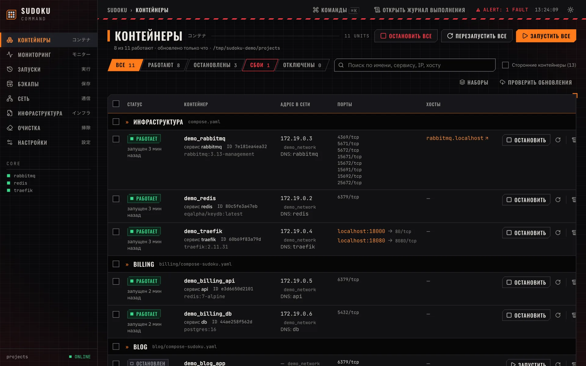
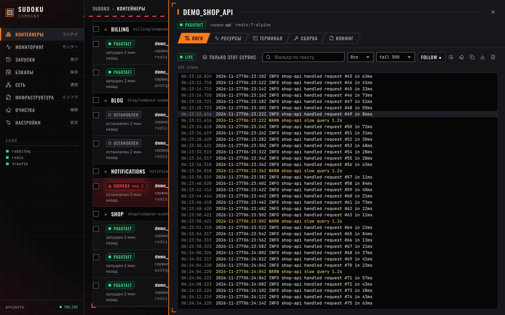
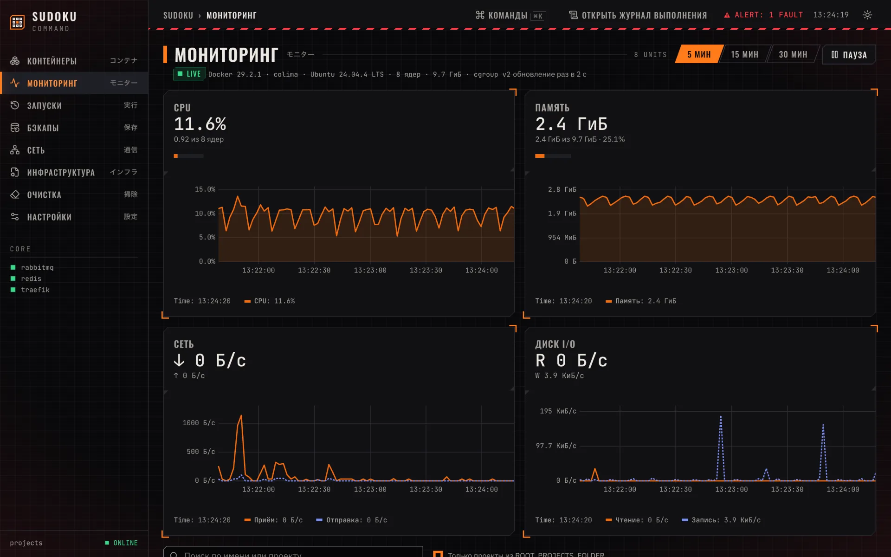
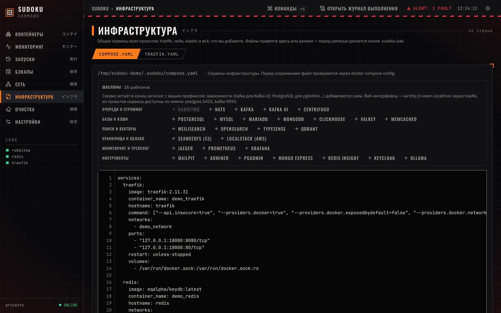
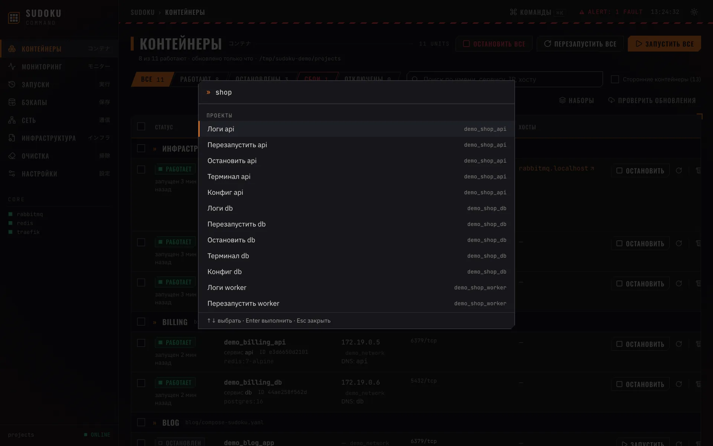

<p align="center">
  
</p>

<p align="center">🇷🇺 <a href="README.md">Русская версия</a></p>

**sudoku** runs a local development environment built from Docker Compose: shared infrastructure (Traefik, Redis,
Elasticsearch and whatever you add) plus projects, each with its own `compose-sudoku.yaml`. One command starts
everything in the right order, and the built-in web admin shows state, logs and resource usage and lets you manage
containers without a terminal.

A single dependency-free binary for macOS, Linux and Windows. All it needs is Docker.

<p align="center">
  
</p>

The admin UI is in Russian.

## Contents

* [How it works](#how-it-works)
* [Installation](#installation)
  * [macOS](#macos) · [Linux](#linux) · [Windows](#windows)
  * [What setup asks](#what-setup-asks)
  * [Updating](#updating) · [Moving from an old install](#moving-from-an-old-install) · [Uninstalling](#uninstalling)
  * [Building from source](#building-from-source)
* [Commands](#commands)
* [Admin](#admin)
* [Configuration](#configuration)
* [Infrastructure](#infrastructure)
* [Security](#security)
* [Development](#development)

## How it works

You have a folder with your projects. A project that sudoku should manage contains a `compose-sudoku.yaml`:

```
~/projects/                     ← projects folder (ROOT_PROJECTS_FOLDER)
├── shop/compose-sudoku.yaml
├── billing/compose-sudoku.yaml
└── blog/compose-sudoku.yaml
```

Shared services used by all projects live in a separate `compose.yaml` in the sudoku folder (`~/.sudoku`). All
containers share the `sudoku_network` network, so a project reaches the infrastructure by service name:
`redis:6379`, `postgres:5432`. Traefik serves web UIs on addresses like `http://shop.localhost`.

`sudoku start` brings up the infrastructure, waits for its healthchecks and then starts the projects. You can also
start single projects, services or saved sets.

## Installation

Install Docker with Compose first: [Docker Desktop](https://www.docker.com/products/docker-desktop/), Colima,
OrbStack, Rancher Desktop or Docker Engine on Linux. Make sure `docker ps` and `docker compose version` work.

Then download sudoku for your system and run `setup`. It asks a couple of questions and puts everything in place.

### macOS

```sh
# Apple Silicon (M1–M4). For an Intel Mac replace arm64 with amd64.
curl -fsSL https://github.com/KaoriEl/sudoku-golang/releases/latest/download/sudoku_darwin_arm64.tar.gz | tar xz sudoku
./sudoku setup
```

If you downloaded the archive with a browser, macOS will refuse to run the unsigned binary. Remove the quarantine
flag: `xattr -d com.apple.quarantine ./sudoku`.

### Linux

```sh
# x86_64. For ARM (aarch64) replace amd64 with arm64. Check with: uname -m
curl -fsSL https://github.com/KaoriEl/sudoku-golang/releases/latest/download/sudoku_linux_amd64.tar.gz | tar xz sudoku
./sudoku setup
```

Your user needs access to Docker without `sudo` (the `docker` group or rootless Docker).

### Windows

In PowerShell:

```powershell
# x64. For ARM replace amd64 with arm64.
Invoke-WebRequest https://github.com/KaoriEl/sudoku-golang/releases/latest/download/sudoku_windows_amd64.zip -OutFile sudoku.zip
Expand-Archive sudoku.zip -DestinationPath sudoku-install
.\sudoku-install\sudoku.exe setup
```

Open a new terminal window afterwards so the updated `PATH` is picked up.

All archives are on the [releases page](https://github.com/KaoriEl/sudoku-golang/releases/latest).

### What setup asks

`setup` asks for:

1. the projects folder (`~` works; a missing folder is created only if you agree);
2. the container prefix for the infrastructure (`dev` → `dev_traefik`, `dev_redis`);
3. whether to use the `docker` and `docker compose` it found (it shows the path and version; answer `n` to type your
   own, which is checked before it is saved);
4. after a summary of what goes where, whether to continue, and whether to add the binary folder to `PATH`.

Where things go:

| What | macOS, Linux | Windows |
|---|---|---|
| the `sudoku` command | `~/.local/bin/sudoku` | `%LOCALAPPDATA%\Programs\sudoku\sudoku.exe` |
| settings, infrastructure, data, backups | `~/.sudoku` | `%USERPROFILE%\.sudoku` |
| your projects | stay where they are | stay where they are |

The downloaded archive is no longer needed. From now on use `sudoku` from any folder:

```sh
sudoku doctor     # check docker, compose, ports, permissions
sudoku start      # start the infrastructure and projects
sudoku serve      # open the admin at http://127.0.0.1:7777
```

`setup` can be run again, for example to change the projects folder. It never overwrites existing configs. For
scripts there is a non-interactive mode: `sudoku setup --root ~/projects --prefix dev --yes`. The settings folder can
be moved with the `SUDOKU_HOME` variable.

### Updating

```sh
sudoku update
```

It downloads the latest release for your system, verifies its SHA-256 against `checksums.txt` and replaces the
binary. No new `setup` is needed. The same is available in the admin: Settings → Version → check for updates, then
update and restart the admin.

### Moving from an old install

Older versions kept `sudoku`, `.env`, `compose.yaml` and `sudoku-config/` inside the projects folder. `setup` finds
such an install by itself and offers to move it into `~/.sudoku` together with the data (`sudoku-config/*/data`,
backups). Infrastructure containers are recreated from the new place; project containers and the network are left
alone. To point at the folder explicitly: `sudoku setup --migrate-from <folder>`. The old layout also keeps working
if you don't move it.

### Uninstalling

If you enabled autostart of the admin, turn it off in the settings first. Then:

```sh
sudoku down infra                # stop and remove the infrastructure containers
rm ~/.local/bin/sudoku
rm -rf ~/.sudoku                 # configs and infrastructure data (redis, elastic…), permanently
```

Remove the `# sudoku` `PATH` line from `~/.zshrc` (or `~/.bashrc`) by hand. On Windows delete
`%LOCALAPPDATA%\Programs\sudoku` and `%USERPROFILE%\.sudoku` and remove the folder from your user `PATH`.

### Building from source

Requires Go and Node.js with npm.

```sh
git clone https://github.com/KaoriEl/sudoku-golang.git && cd sudoku-golang
make build        # builds the admin UI and the binary, then runs sudoku setup
```

A `.env` in the repository root is optional; if present, its values become the template for `~/.sudoku/.env`.
Other targets: `make bin` (binary only, into `build/`), `make cross` (all platforms into `build/dist`), `make test`,
`make lint`.

## Commands

```sh
sudoku start [targets...]   # start; without targets everything, infrastructure first
sudoku stop | down | restart | build | rebuild | force-build | force-rebuild [targets...]
sudoku status [targets...]  # status table (--json; -a includes foreign containers)
sudoku logs <targets...> -f # logs (--tail, --since, -t)
sudoku exec <service> [-- command...]   # shell or command in a container (-u user, -T no TTY)
sudoku sets list | add <name> <targets...> | rm <name>   # project sets
sudoku doctor               # diagnostics (--json)
sudoku serve                # web admin
sudoku setup                # install, change the projects folder, move an old install
sudoku update [--check]     # update to the latest release
sudoku version
sudoku completion bash|zsh|fish|powershell
```

A target is a project name (folder with `compose-sudoku.yaml`), the word `infra`, a service name from any project, a
`project/service` pair or a pattern like `api-*`. Sets are passed with `--set`:

```sh
sudoku start infra shop billing/worker
sudoku restart --set backend --no-wait
sudoku logs infra/traefik -f
sudoku exec billing/db -- psql -U postgres
```

Global flags: `--debug` prints every command it runs, `--log` enables a detailed log. `start`, `restart` and `rebuild`
accept `--no-wait` (don't wait for infrastructure healthchecks) and `--no-preflight` (don't check busy ports). If any
compose file fails, the exit code is 1.

Target completion: `source <(sudoku completion zsh)`, in PowerShell
`sudoku completion powershell | Out-String | Invoke-Expression`.

## Admin

`sudoku serve` opens the admin on `http://127.0.0.1:7777`. It is built into the binary and only reachable from this
computer. It can start automatically at login: Settings → Autostart.

**Logs.** Every container has a panel with live logs: text and level filters, highlighted warnings and errors,
download of the full log. The same panel has a terminal inside the container, resource charts, build commands and the
service's final `compose config`.

<p align="center"></p>

**Monitoring.** CPU, memory, network and disk, in total and per container, for the last 30 minutes. Below the charts
there is a sortable container table and how much space images, volumes and build cache take.

<p align="center"></p>

**Infrastructure.** An editor for `compose.yaml` and `traefik.yaml`. Services can be added from templates: RabbitMQ,
NATS, Kafka, PostgreSQL, MySQL, MongoDB, ClickHouse, Meilisearch, OpenSearch, Grafana, Jaeger, Keycloak and about
fifteen more. Before saving, the file is checked with `docker compose config`, and the previous version is kept in
`*.sudoku.bak`. "Save and apply" brings the change up right away.

<p align="center"></p>

**Command palette.** `⌘K` or `Ctrl+K`: type a service name and pick an action (logs, restart, terminal, config). It
also jumps to any page.

<p align="center"></p>

Also in the admin:

* start, stop and restart everything, one project, one service or the containers ticked in the list;
* a "don't start" flag on a service, respected by both the admin and the CLI;
* sets: named groups of projects started with one button;
* run history with the output of every step;
* notifications when a container crashes, fails its healthcheck or runs out of memory;
* a busy-port check before starting;
* backups and restore for PostgreSQL, MySQL/MariaDB, MongoDB and Redis/KeyDB/Valkey;
* Traefik ports: add, remove, apply;
* domains: hosts-file entries and a local HTTPS certificate via mkcert;
* image update checks without pulling;
* disk cleanup of unused images and build cache; volumes are never removed;
* `.env` editor, sudoku self-update and admin restart in the settings.

## Configuration

Settings live in `~/.sudoku/.env`. Change them in the admin (Settings → sudoku config) or by hand.

| Variable | Meaning | Default |
|---|---|---|
| `ROOT_PROJECTS_FOLDER` | projects folder | set by `setup` |
| `PREFIX_CONTAINER_NAME` | infrastructure container prefix | `dev` |
| `DOCKER_PATH` | docker command | found by `setup` |
| `DOCKER_COMPOSE_PATH` | compose command | found by `setup` |
| `MAX_WORKERS` | how many compose files are stopped in parallel (1–64) | `5` |
| `ADMIN_ADDR` | admin address: `127.0.0.1:port` or `unix:/path.sock` | `127.0.0.1:7777` |
| `ADMIN_TOKEN` | admin login token | not set |

A value can also come from an environment variable or the file `/vault/secrets/CRED_<NAME>`. The Docker Engine is
located the same way the docker CLI does it: `DOCKER_HOST`, then the current `docker context`, then the default
socket.

Admin settings (start order, notifications, schedules, backups, metrics) are stored in
`~/.sudoku/sudoku-config/admin.yaml`, sets in `sets.yaml`, disabled services in `disabled.yaml`. These files can be
edited by hand.

## Infrastructure

By default `~/.sudoku/compose.yaml` contains:

| Service | Image | Purpose |
|---|---|---|
| traefik | `traefik:2.11.31` | serves projects on `*.localhost` domains, proxies TCP; dashboard on `127.0.0.1:8080` |
| redis | `eqalpha/keydb` | cache, data in `sudoku-config/redis/data` |
| elasticsearch | `elasticsearch:9.1.8` | search, data in `sudoku-config/elasticsearch/data` |

Traefik's config is `sudoku-config/traefik/traefik.yaml`; extra rules go into `sudoku-config/traefik/custom/`.
Anything else is added in the admin's infrastructure editor or directly in `compose.yaml`. To let a project reach the
infrastructure, attach it to the external network:

```yaml
networks:
  sudoku_network:
    name: sudoku_network
    external: true
```

## Security

The admin listens only on `127.0.0.1`, `::1` or a unix socket and rejects requests from other sites. On shared
machines set `ADMIN_TOKEN`: login is then possible only through the tokenised link printed by `sudoku serve`. Don't
expose the admin to the network: it controls Docker on your computer.

## Development

```sh
make test        # go test -race ./...
make lint        # golangci-lint
make serve       # build the UI and run the API on :7777
make web-dev     # Vite on :5173, /api is proxied to :7777
```

CLI code lives in `internal/`, the admin UI in `web/` (React + TypeScript), the UI design rules in `.agents/design/`.
Releases are built by GitHub Actions on every push to `master`; the next version number is set automatically.
