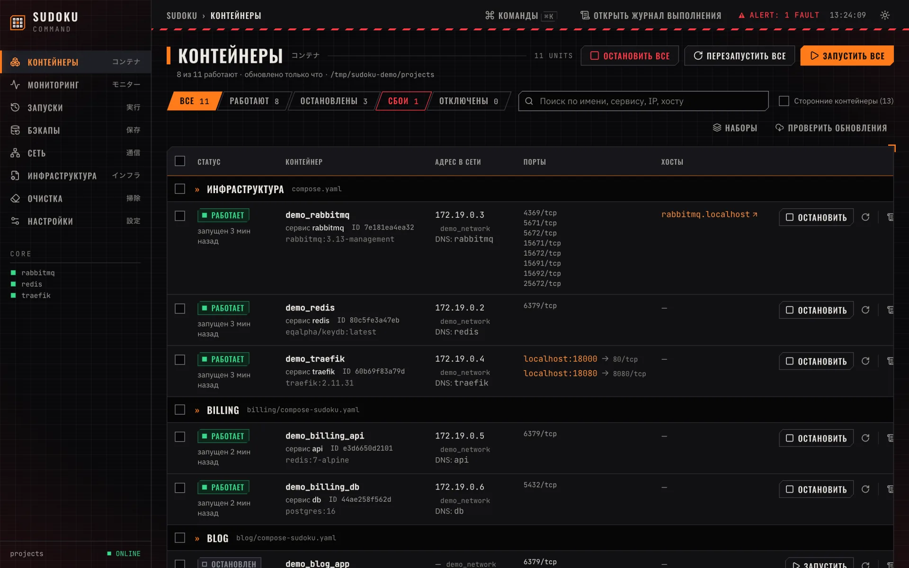
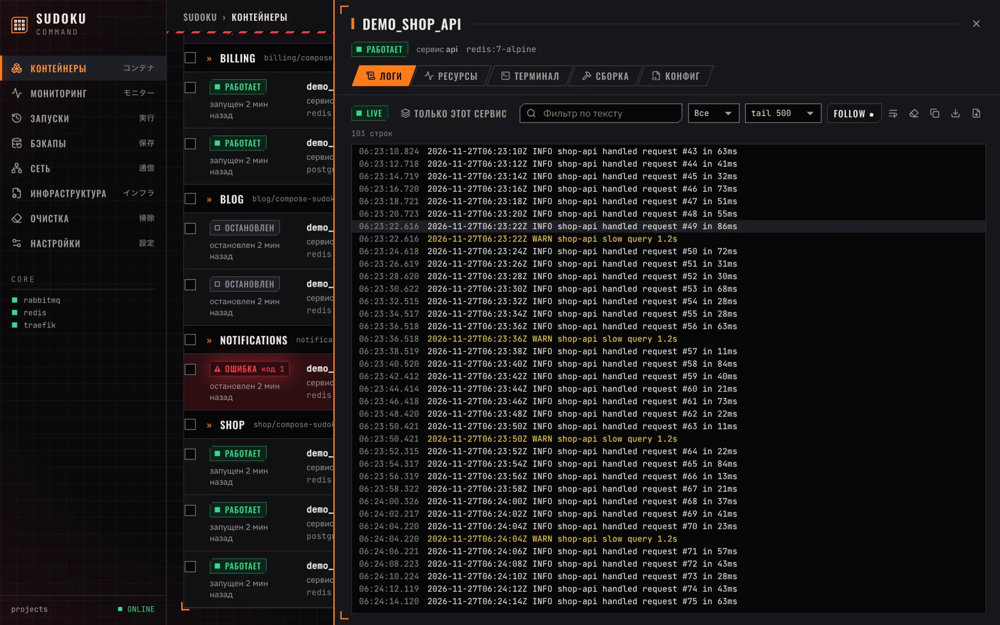
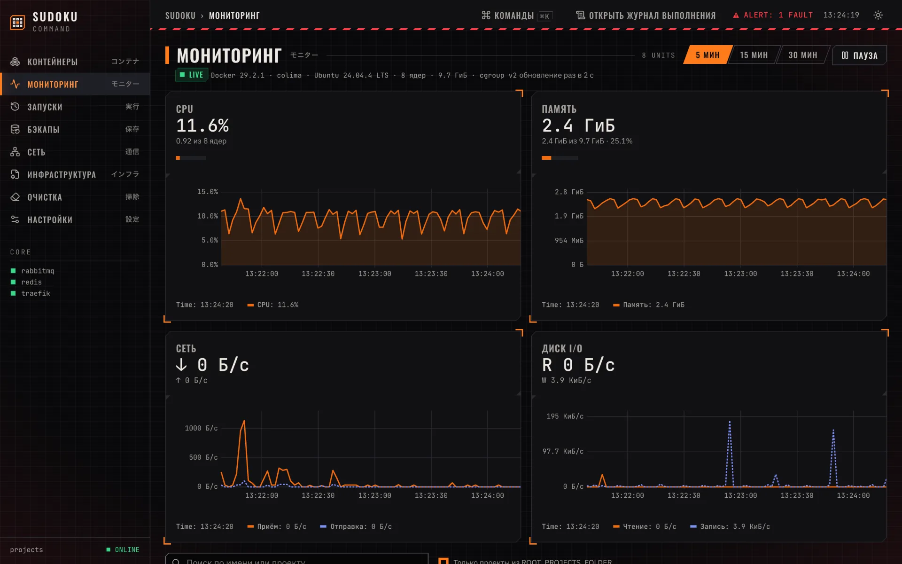
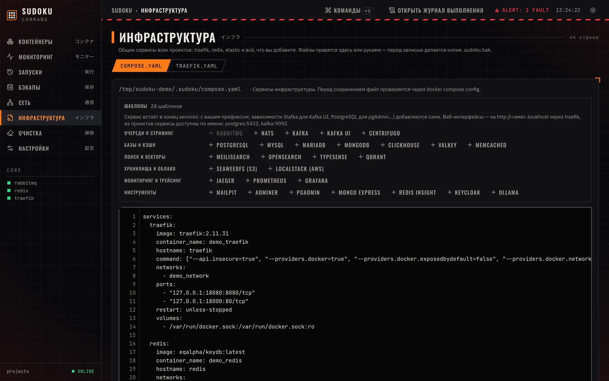
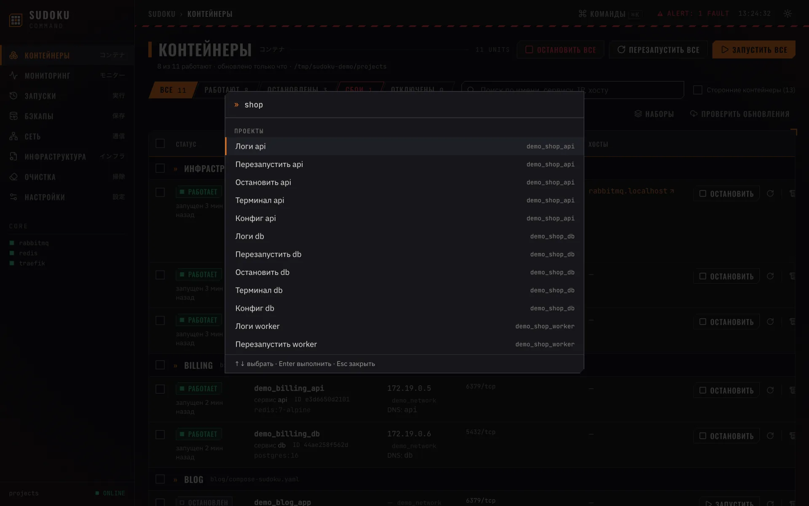

<p align="center">
  
</p>

<p align="center">🇬🇧 <a href="README.en.md">English version</a></p>

**sudoku** запускает локальное окружение разработки, собранное из Docker Compose: общую инфраструктуру (Traefik,
Redis, Elasticsearch и всё, что вы добавите) и проекты, у каждого из которых свой `compose-sudoku.yaml`. Одна команда
поднимает всё в правильном порядке, а встроенная веб-админка показывает состояние, логи, нагрузку и позволяет
управлять контейнерами без терминала.

Один бинарник без зависимостей для macOS, Linux и Windows. Нужен только Docker.

<p align="center">
  
</p>

## Содержание

* [Как это устроено](#как-это-устроено)
* [Установка](#установка)
  * [macOS](#macos) · [Linux](#linux) · [Windows](#windows)
  * [Что спрашивает setup](#что-спрашивает-setup)
  * [Обновление](#обновление) · [Переезд со старой версии](#переезд-со-старой-версии) · [Удаление](#удаление)
  * [Сборка из исходников](#сборка-из-исходников)
* [Команды](#команды)
* [Админка](#админка)
* [Настройка](#настройка)
* [Инфраструктура](#инфраструктура)
* [Безопасность](#безопасность)
* [Разработка](#разработка)

## Как это устроено

У вас есть папка, в которой лежат проекты. Проект, которым должен управлять sudoku, содержит файл
`compose-sudoku.yaml`:

```
~/projects/                     ← папка проектов (ROOT_PROJECTS_FOLDER)
├── shop/compose-sudoku.yaml
├── billing/compose-sudoku.yaml
└── blog/compose-sudoku.yaml
```

Общие сервисы, которыми пользуются все проекты, описаны в отдельном `compose.yaml` в папке sudoku (`~/.sudoku`).
Все контейнеры живут в одной сети `sudoku_network`, поэтому проект обращается к инфраструктуре по имени сервиса:
`redis:6379`, `postgres:5432`. Traefik раздаёт веб-интерфейсы по адресам вида `http://shop.localhost`.

`sudoku start` поднимает инфраструктуру, ждёт её healthcheck и затем запускает проекты. Можно запускать не всё, а
отдельные проекты, сервисы или сохранённые наборы.

## Установка

Сначала поставьте Docker с Compose: [Docker Desktop](https://www.docker.com/products/docker-desktop/), Colima,
OrbStack, Rancher Desktop или Docker Engine на Linux. Проверьте, что `docker ps` и `docker compose version` работают.

Дальше скачайте sudoku для своей системы и запустите `setup`. Он задаст пару вопросов и всё разложит по местам.

### macOS

```sh
# Mac на Apple Silicon (M1–M4). Для Mac на Intel замените arm64 на amd64.
curl -fsSL https://github.com/KaoriEl/sudoku-golang/releases/latest/download/sudoku_darwin_arm64.tar.gz | tar xz sudoku
./sudoku setup
```

Если скачивали архив через браузер, macOS не даст запустить неподписанный бинарник. Снимите с него метку
карантина: `xattr -d com.apple.quarantine ./sudoku`.

### Linux

```sh
# x86_64. Для ARM (aarch64) замените amd64 на arm64. Узнать архитектуру: uname -m
curl -fsSL https://github.com/KaoriEl/sudoku-golang/releases/latest/download/sudoku_linux_amd64.tar.gz | tar xz sudoku
./sudoku setup
```

Ваш пользователь должен иметь доступ к Docker без `sudo` (группа `docker` или rootless Docker).

### Windows

В PowerShell:

```powershell
# x64. Для ARM замените amd64 на arm64.
Invoke-WebRequest https://github.com/KaoriEl/sudoku-golang/releases/latest/download/sudoku_windows_amd64.zip -OutFile sudoku.zip
Expand-Archive sudoku.zip -DestinationPath sudoku-install
.\sudoku-install\sudoku.exe setup
```

После установки откройте новое окно терминала, чтобы подхватился обновлённый `PATH`.

Все архивы есть на [странице релизов](https://github.com/KaoriEl/sudoku-golang/releases/latest).

### Что спрашивает setup

```
Папка с вашими проектами [~/projects]: ~/work
Префикс имён контейнеров инфраструктуры (<префикс>_traefik, <префикс>_redis…) [dev]:
ℹ Найден docker: /opt/homebrew/bin/docker (версия 29.4.0)
Использовать его? [Y/n]:
ℹ Найден docker compose: /opt/homebrew/bin/docker compose (версия 2.39.1)
Использовать его? [Y/n]:

ℹ Будет установлено:
  команда sudoku      ~/.local/bin/sudoku
  настройки (.env)    ~/.sudoku/.env
  инфраструктура      ~/.sudoku/compose.yaml, ~/.sudoku/sudoku-config
  папка с проектами   ~/work
  префикс контейнеров dev

Продолжить? [Y/n]:
…
Добавить ~/.local/bin в PATH (~/.zshrc), чтобы команда sudoku работала из любой папки? [Y/n]:
```

Если найденный docker не подходит, ответьте `n` и введите свой путь. Он будет проверен перед записью.

Куда что ставится:

| Что | macOS, Linux | Windows |
|---|---|---|
| команда `sudoku` | `~/.local/bin/sudoku` | `%LOCALAPPDATA%\Programs\sudoku\sudoku.exe` |
| настройки, инфраструктура, данные, бэкапы | `~/.sudoku` | `%USERPROFILE%\.sudoku` |
| ваши проекты | остаются на месте | остаются на месте |

Скачанный архив после этого не нужен. Дальше всё делается командой `sudoku` из любой папки:

```sh
sudoku doctor     # проверить окружение: docker, compose, порты, права
sudoku start      # поднять инфраструктуру и проекты
sudoku serve      # открыть админку на http://127.0.0.1:7777
```

`setup` можно запускать повторно, например чтобы сменить папку проектов. Существующие конфиги он не перезаписывает.
Для скриптов есть режим без вопросов: `sudoku setup --root ~/projects --prefix dev --yes`. Папку настроек можно
перенести через переменную `SUDOKU_HOME`.

### Обновление

```sh
sudoku update
```

Команда скачивает последний релиз под вашу систему, сверяет SHA-256 с `checksums.txt` и заменяет бинарник. Повторно
запускать `setup` не нужно. То же самое можно сделать в админке: «Настройки → Версия → Проверить обновления», затем
«Обновить» и «Перезапустить админку».

### Переезд со старой версии

Раньше `sudoku`, `.env`, `compose.yaml` и `sudoku-config/` лежали прямо в папке проектов. `setup` находит такую
установку сам и предлагает перенести её в `~/.sudoku` вместе с данными (`sudoku-config/*/data`, бэкапы). Контейнеры
инфраструктуры пересоздаются из нового места, контейнеры проектов и сеть не трогаются. Указать папку явно можно так:
`sudoku setup --migrate-from <папка>`. Без переноса старая раскладка тоже продолжает работать.

### Удаление

Если включали автозапуск админки, выключите его в «Настройках». Потом:

```sh
sudoku down infra                # остановить и удалить контейнеры инфраструктуры
rm ~/.local/bin/sudoku
rm -rf ~/.sudoku                 # конфиги и данные инфраструктуры (redis, elastic…), без возврата
```

Строку `# sudoku` с `PATH` из `~/.zshrc` (или `~/.bashrc`) можно удалить вручную. На Windows удалите
`%LOCALAPPDATA%\Programs\sudoku` и `%USERPROFILE%\.sudoku`, а путь уберите из переменной `PATH` пользователя.

### Сборка из исходников

Нужны Go и Node.js с npm.

```sh
git clone https://github.com/KaoriEl/sudoku-golang.git && cd sudoku-golang
make build        # собирает админку и бинарник, затем запускает sudoku setup
```

`.env` в корне репозитория необязателен. Если он есть, его значения станут шаблоном для `~/.sudoku/.env`.
Другие цели: `make bin` (только бинарник в `build/`), `make cross` (все платформы в `build/dist`), `make test`,
`make lint`.

## Команды

```sh
sudoku start [цели...]      # запустить; без целей — всё, инфраструктура первой
sudoku stop | down | restart | build | rebuild | force-build | force-rebuild [цели...]
sudoku status [цели...]     # таблица состояния (--json; -a — вместе с чужими контейнерами)
sudoku logs <цели...> -f    # логи (--tail, --since, -t)
sudoku exec <сервис> [-- команда...]   # shell или команда в контейнере (-u пользователь, -T без TTY)
sudoku sets list | add <имя> <цели...> | rm <имя>   # наборы проектов
sudoku doctor               # диагностика (--json)
sudoku serve                # веб-админка
sudoku setup                # установка, смена папки проектов, перенос старой установки
sudoku update [--check]     # обновиться до последнего релиза
sudoku version
sudoku completion bash|zsh|fish|powershell
```

Цель может быть именем проекта (папка с `compose-sudoku.yaml`), словом `infra`, именем сервиса из любого проекта,
парой `проект/сервис` или шаблоном вроде `api-*`. Наборы указываются флагом `--set`:

```sh
sudoku start infra shop billing/worker
sudoku restart --set backend --no-wait
sudoku logs infra/traefik -f
sudoku exec billing/db -- psql -U postgres
```

Общие флаги: `--debug` печатает каждую выполняемую команду, `--log` включает подробный лог. `start`, `restart` и
`rebuild` принимают `--no-wait` (не ждать healthcheck инфраструктуры) и `--no-preflight` (не проверять занятые порты).
Если хотя бы один compose-файл завершился ошибкой, код выхода будет 1.

Автодополнение целей: `source <(sudoku completion zsh)`, в PowerShell
`sudoku completion powershell | Out-String | Invoke-Expression`.

## Админка

`sudoku serve` открывает админку на `http://127.0.0.1:7777`. Она встроена в бинарник и работает только на этом
компьютере. Её можно запускать автоматически при входе в систему: «Настройки → Автозапуск».

**Логи.** У каждого контейнера есть панель с логами в реальном времени: фильтр по тексту и уровню, подсветка
предупреждений и ошибок, скачивание полного лога. Там же терминал внутри контейнера, графики ресурсов, команды сборки
и итоговый `compose config` сервиса.

<p align="center"></p>

**Мониторинг.** CPU, память, сеть и диск: в сумме и по каждому контейнеру, за последние 30 минут. Ниже графиков есть
таблица контейнеров с сортировкой и данные о том, сколько места занимают образы, тома и кэш сборки.

<p align="center"></p>

**Инфраструктура.** Редактор `compose.yaml` и `traefik.yaml`. Сервис можно добавить из готового шаблона: RabbitMQ,
NATS, Kafka, PostgreSQL, MySQL, MongoDB, ClickHouse, Meilisearch, OpenSearch, Grafana, Jaeger, Keycloak и ещё полтора
десятка. Перед сохранением файл проверяется через `docker compose config`, предыдущая версия сохраняется в
`*.sudoku.bak`. Кнопка «Сохранить и применить» сразу поднимает изменения.

<p align="center"></p>

**Палитра команд.** `⌘K` или `Ctrl+K`: начните вводить имя сервиса и выберите действие (логи, перезапуск,
терминал, конфиг). Через неё же можно перейти в любой раздел.

<p align="center"></p>

Что ещё есть в админке:

* запуск, остановка и перезапуск всего сразу, отдельного проекта, сервиса или выбранных галочками контейнеров;
* флаг «не запускать» на сервисе, его учитывают и админка, и CLI;
* наборы: именованные группы проектов, которые запускаются одной кнопкой;
* история запусков с выводом каждого шага;
* уведомления, когда контейнер упал, не прошёл healthcheck или упёрся в лимит памяти;
* проверка занятых портов перед запуском;
* бэкапы и восстановление PostgreSQL, MySQL/MariaDB, MongoDB и Redis/KeyDB/Valkey;
* порты Traefik: добавить, убрать, применить;
* домены: запись в hosts-файл и локальный HTTPS-сертификат через mkcert;
* проверка обновлений образов без скачивания;
* очистка диска от неиспользуемых образов и кэша сборки, тома при этом не удаляются никогда;
* редактор `.env`, обновление sudoku и перезапуск админки из «Настроек».

## Настройка

Настройки лежат в `~/.sudoku/.env`. Их можно поменять в админке («Настройки → Конфиг sudoku») или вручную.

| Переменная | Что задаёт | По умолчанию |
|---|---|---|
| `ROOT_PROJECTS_FOLDER` | папка проектов | задаётся в `setup` |
| `PREFIX_CONTAINER_NAME` | префикс контейнеров инфраструктуры | `dev` |
| `DOCKER_PATH` | команда docker | находит `setup` |
| `DOCKER_COMPOSE_PATH` | команда compose | находит `setup` |
| `MAX_WORKERS` | сколько compose-файлов останавливать параллельно (1–64) | `5` |
| `ADMIN_ADDR` | адрес админки: `127.0.0.1:порт` или `unix:/путь.sock` | `127.0.0.1:7777` |
| `ADMIN_TOKEN` | токен для входа в админку | не задан |

Значение также можно передать переменной окружения или файлом `/vault/secrets/CRED_<ИМЯ>`. Docker Engine ищется так
же, как это делает docker CLI: `DOCKER_HOST`, затем текущий `docker context`, затем стандартный сокет.

Настройки админки (порядок запуска, уведомления, расписания, бэкапы, метрики) хранятся в
`~/.sudoku/sudoku-config/admin.yaml`, наборы в `sets.yaml`, отключённые сервисы в `disabled.yaml`. Эти файлы можно
править руками.

## Инфраструктура

По умолчанию `~/.sudoku/compose.yaml` содержит:

| Сервис | Образ | Зачем |
|---|---|---|
| traefik | `traefik:2.11.31` | раздаёт проекты по доменам `*.localhost`, проксирует TCP; панель на `127.0.0.1:8080` |
| redis | `eqalpha/keydb` | кэш, данные в `sudoku-config/redis/data` |
| elasticsearch | `elasticsearch:9.1.8` | поиск, данные в `sudoku-config/elasticsearch/data` |

Конфиг Traefik лежит в `sudoku-config/traefik/traefik.yaml`, дополнительные правила кладутся в
`sudoku-config/traefik/custom/`. Остальное добавляется в редакторе инфраструктуры в админке или прямо в
`compose.yaml`. Чтобы проект видел инфраструктуру, подключите его к внешней сети:

```yaml
networks:
  sudoku_network:
    name: sudoku_network
    external: true
```

## Безопасность

Админка слушает только `127.0.0.1`, `::1` или unix-сокет и отклоняет запросы с чужих сайтов. На общих машинах задайте
`ADMIN_TOKEN`: тогда вход возможен только по ссылке с токеном, которую печатает `sudoku serve`. Не открывайте админку
наружу: через неё можно управлять Docker на вашем компьютере.

## Разработка

```sh
make test        # go test -race ./...
make lint        # golangci-lint
make serve       # собрать интерфейс и запустить API на :7777
make web-dev     # Vite на :5173, запросы /api уходят на :7777
```

Код CLI находится в `internal/`, интерфейс админки в `web/` (React + TypeScript), правила оформления интерфейса в
`.agents/design/`. Релиз собирается GitHub Actions на каждый пуш в `master`: следующий номер версии выставляется
автоматически.
